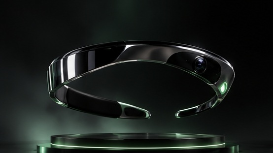

# NOCTRA
### Objects from tomorrow, made for today.

NOCTRA is a futuristic lifestyle concept exploring the intersection of creativity, technology, and everyday objects.

**THE FUTURE ISN'T ORDINARY.**

## ✦ Preview



## ✦ About the Project

NOCTRA reimagines ordinary objects as extraordinary futuristic inventions. This landing page presents a collection of imaginative products through a premium, dark visual experience.

## ✦ Our Collection

| Product | Concept |
|---|---|
| AURA | The Camera Tiara |
| LUMA | The Projector Lamp |
| ECHO | Futuristic Audio Accessory |
| ORBIT | Futuristic Clock |

## ✦ Features

- Futuristic and responsive landing page
- Interactive product descriptions
- Image-based product collection
- Smooth CSS hover effects
- Mobile-friendly layout

## ✦ Technologies Used

- HTML5
- CSS3

## ✦ Project Structure

```text
WebDev-L1-Landingpage/
│
├── index.html
├── style.css
├── README.md
└── images/
    ├── hero.jpg
    ├── philosophy.jpg
    ├── aura.jpg
    ├── luma.jpg
    ├── echo.jpg
    ├── orbit.jpg
    ├── studio.jpg
    ├── vision.jpg
    └── final.jpg
```

## ✦ Author

Created by **Hayat Kedir**

---

*NOCTRA — Imagine beyond the ordinary.*
